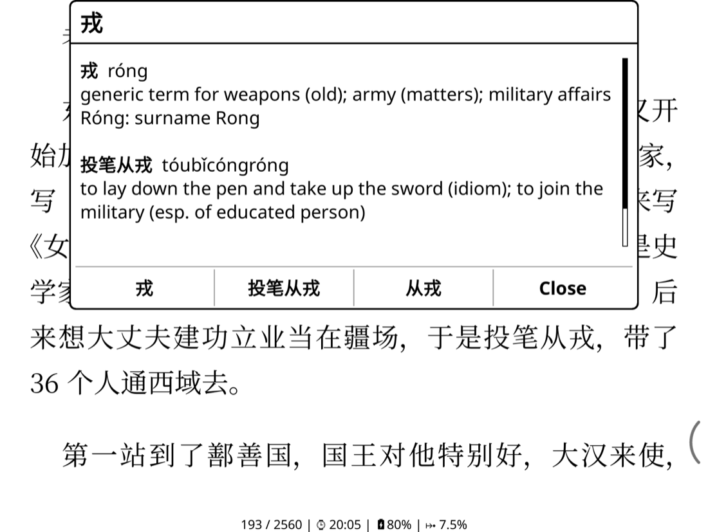

# koreader-chinese-popup

A [KOReader](https://github.com/koreader/koreader) plugin for reading Chinese: **tap a Chinese
character** to see its CC-CEDICT entry and every dictionary word around it that contains it, with
a one-tap button per word that opens KOReader's own dictionary lookup.



Nothing is prepared in advance: no pre-processing of pages or books. All the work happens when you
tap: 7–20 ms per tap on a Boox Go 7, measured from the tap to the popup being built (the first
tap in a book also opens the dictionary, about 20–30 ms).

It is a companion to [koreader-interlinear-pinyin](https://github.com/scartoon/koreader-interlinear-pinyin),
which shows pinyin above rare characters. The two are separate plugins; install either or both.

## What a tap does

- **A single tap on a Chinese character** (CJK Unified Ideographs, all extensions, and the
  compatibility ideographs) opens the popup. The tap must land on the character's glyph, not just
  near it.
- **Every other tap is KOReader's as usual**: margins, the space between lines, blank space after a
  paragraph, punctuation, Latin text and digits all turn the page or open the menus. Taps on links
  and on existing highlights keep their usual behaviour.
- **Long-press and every other gesture are untouched**, so KOReader's long-press dictionary and
  text selection work exactly as before.
- There is no per-book language setting: the per-character check is the only rule, so books mixing
  English and Chinese work.
- Reflowable documents only (EPUB, FB2, MOBI, HTML, TXT…). On PDF and DjVu every tap is KOReader's.

## What the popup shows

The plugin reads up to 7 characters before and 7 after the tapped one, following the text across
line and page breaks and stopping at punctuation, a paragraph break or any non-Chinese character.
It then looks up every 1–8 character substring that contains the tapped character, in one SQLite
query, against both simplified and traditional forms. There is no word-segmentation guess: every
dictionary word that fits is shown.

- The tapped character's own entry comes first.
- Then the words, longest first; words of the same length in reading order.
- Each entry: the word, its pinyin with tone marks, and its definitions. Further readings of the
  same word follow on their own lines (ordinary readings before surnames and place names).
- Below: one button per entry, labelled with the word, that opens KOReader's dictionary lookup for
  it (the same lookup as long-press), plus **Close**. Buttons wrap four to a row.
- If CC-CEDICT has nothing for the character or any word around it, the tap goes straight to
  KOReader's dictionary lookup.

## Install

1. Download `chinesepopup.koplugin.zip` from the
   [latest release](https://github.com/scartoon/koreader-chinese-popup/releases/latest) and unzip
   it. You get a `chinesepopup.koplugin` folder, which includes the dictionary
   (`data/cedict.sqlite`, about 14 MB).
2. Copy that folder into KOReader's `plugins` folder:
   - **Android** (Boox and others): `/sdcard/koreader/plugins/`, which appears as
     `koreader/plugins` in the device's internal storage when connected over USB. With adb:
     `adb push chinesepopup.koplugin /sdcard/koreader/plugins/`
   - Other devices: the `plugins` folder inside KOReader's own folder.
3. Restart KOReader.

The folder must keep its name, `chinesepopup.koplugin`. The repository itself does not contain the
dictionary (see [Dictionary data](#dictionary-data)); to install from a clone, build it first.

## Usage

Open a book and tap a character. To turn the plugin off or on: **Tools (wrench) → Chinese popup →
Tap a Chinese character for its words**. The setting is saved and applies to all books.

## With the interlinear-pinyin plugin

Both plugins listen for taps on Chinese characters. The interlinear-pinyin plugin claims only taps
on characters it has annotated (the character or the pinyin drawn above it), and its tap zone lists
this plugin's zone (`chinesepopup_tap`) in its `overrides`, so KOReader always asks it first:

- A tap on an **annotated** character (or its pinyin) opens the pinyin plugin's popup.
- A tap on **any other** character opens this plugin's popup.
- With pinyin **turned off** (or its "Tap annotated character for definitions" option off), the
  pinyin plugin claims nothing and every character tap comes here.

That ordering needs a koreader-interlinear-pinyin version newer than 0.5.0, one that includes the
commit "Tap zone runs before the chinese-popup plugin's". With an older version, which plugin gets a
tap on an annotated character depends on plugin load order. The ordering is set by the zones' ids,
not by load order. Each plugin works fully without the other.

## Dictionary data

The plugin uses [CC-CEDICT](https://www.mdbg.net/chinese/dictionary?page=cc-cedict), converted to a
SQLite database that KOReader opens through its bundled SQLite library. The database is opened on
the first tap and kept open while the book is.

The built database is about 14 MB (7 MB compressed) and changes completely with each CC-CEDICT
update, so it is **not committed**: every rebuild would add another 14 MB of binary history. It is
attached to each GitHub release instead, inside the ready-to-install zip.

To rebuild it (Python 3, no other dependencies):

```sh
python3 tools/build_db.py                       # downloads the current CC-CEDICT
python3 tools/build_db.py --cedict cedict_1_0_ts_utf-8_mdbg.txt.gz   # or use a local copy
```

This writes `chinesepopup.koplugin/data/cedict.sqlite`, with one row per CC-CEDICT entry
(simplified, traditional, pinyin with tone marks, definitions) and indexes on the simplified and
traditional columns. The script checks that the lookup query uses both indexes and fails otherwise.
Numbered pinyin is converted to tone marks, and cross-references inside definitions are made
readable (`variant of 夠|够[gou4]` → `variant of 够 gòu`), the same way as in the
interlinear-pinyin plugin.

The release currently ships CC-CEDICT dated 2026-11-09 (125,397 entries).

## Development

```sh
tools/check.sh      # luac -p on every Lua file, then the offline tests (LuaJIT)
tools/deploy.sh     # check, push to a USB-connected Android device, restart KOReader
```

The tests cover Han detection, candidate generation, ordering, popup text, and the tap-to-character
and context logic against a fake document. They run in plain LuaJIT or Lua (`luajit tests/run.lua`).
`tools/make_test_epub.py` writes a small EPUB (mixed English/Chinese, traditional characters, words
split by inline tags, paragraph breaks) for checking taps on a device.

| File | |
|---|---|
| `main.lua` | tap zone, settings, lookup and popup wiring |
| `cp_text.lua` | Han detection, candidate words, ordering, popup text (pure Lua) |
| `cp_context.lua` | tap → character → surrounding characters, through KOReader's CreDocument |
| `cp_db.lua` | SQLite lookups |
| `cp_popup.lua` | the popup (from the interlinear-pinyin plugin) |

## Credits and licence

The plugin code is licensed under the [GNU General Public License v3.0](LICENSE), like the
interlinear-pinyin plugin it borrows its popup and tap-zone code from.

The dictionary data is derived from **CC-CEDICT**, © MDBG and contributors, licensed under
[Creative Commons Attribution-ShareAlike 4.0](https://creativecommons.org/licenses/by-sa/4.0/)
(https://www.mdbg.net/chinese/dictionary?page=cc-cedict). Changes made: numbered pinyin converted to
tone marks, cross-references reformatted, entries stored in SQLite. The database
(`data/cedict.sqlite`, as shipped in the releases) is distributed under the same CC BY-SA 4.0
licence.
